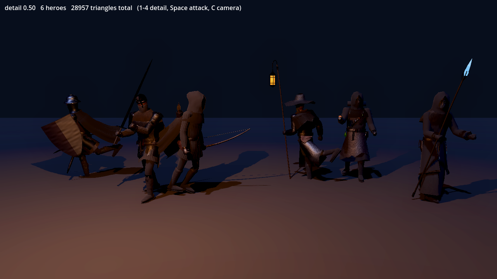

# ProcHero Kit cho Godot 4.4

Bộ dựng hero bằng code (port từ LANTERNFALL sang GDScript). Hero không dùng file model: thân người được "đắp" từ các lát cắt theo bảng tỉ lệ cơ thể, mặc đồ theo từng lớp, skin sẵn vào một bộ xương chung, tô bằng shader vật liệu không cần texture, và có animator thủ tục (đi, chạy, thủ thế, ra đòn, giật lùi khi trúng đòn).



## Chạy thử
Mở thư mục `godot/` bằng Godot 4.4 rồi chạy (F5). Phím `1`–`4` đổi mức chi tiết, `Space` cho cả đội ra đòn, `C` đổi camera.

## Dùng trong game
Chép thư mục `addons/proc_hero/` vào project của bạn.

```gdscript
var h := ProcHero.new()
h.hero_id = "warden"        # warden, reaver, fletcher, lamplighter, apothecary, rimebinder
h.detail = 0.5              # 0.5 cho điện thoại
add_child(h)

h.speed = 1.6               # m/s; bạn tự di chuyển node, animator lo bước chân
h.combat = true             # vào thế thủ
h.play_action("attack", 0.3, 0.45)   # 0.3 s gồng đòn -> khung trúng -> 0.45 s thu đòn
h.action_hit.connect(func(a): enemy.take_damage())   # gây sát thương ĐÚNG khung trúng
enemy_hero.hit_react(dir, true)      # nháy sáng + giật lùi
h.time_scale = 0.0          # hit-stop: đứng hình vài phần trăm giây rồi trả về 1.0
```

Hero quay mặt theo trục +Z.

## Số tam giác (đo trong Godot)

| detail | warden | reaver | fletcher | lamplighter | apothecary | rimebinder |
|---|---|---|---|---|---|---|
| 1.0 + shells (giống bản web) | 28 824 | 19 540 | 17 429 | 18 486 | 16 820 | 18 530 |
| 0.75 | 10 944 | 8 212 | 7 723 | 7 868 | 7 476 | 7 212 |
| **0.5 (mobile)** | **6 368** | **5 082** | **4 289** | **4 518** | **4 424** | **4 276** |
| 0.4 | 4 276 | 3 348 | 2 760 | 2 790 | 2 694 | 2 616 |

Dựng một hero mất khoảng 20–90 ms. Trên điện thoại nên bake sẵn: `godot --headless -s res://tools/bake_all.gd` sẽ lưu mesh ra `res://baked/`, sau đó gán vào `baked_mesh` (hoặc bấm nút "Bake mesh" trong Inspector).

## Các file
| File | Nội dung |
|---|---|
| `geo.gd` | `ProcGeo`: surf, loft, lathe, tube, sphere, skin 2 xương/đỉnh, xuất ArrayMesh |
| `rig.gd` | `ProcRig`: bộ xương người dùng chung, tạo Skeleton3D |
| `hw.gd` | Bảng tỉ lệ cơ thể + mọi món đồ: thân, tay, chân, ủng, áo choàng, mũ trùm, giáp, khiên, kiếm, cung… |
| `heroes.gd` | Công thức 6 hero + tư thế và các đòn đánh của từng hero |
| `anim.gd` | Animator thủ tục: idle, bước chân bám đất, ra đòn 3 pha, stagger, lò xo áo choàng, đèn lồng |
| `clip.gd` | Clip keyframe (mỗi đòn đánh) |
| `surf.gdshader` | Vật liệu thủ tục: vải, áo độn, giáp xích, da, thép gỉ, lông, gỗ… + nháy sáng, tan biến |

## Tự tạo hero mới
Viết thêm một hàm trong `heroes.gd`, ví dụ:

```gdscript
var P := {"sh": 0.2, "hp": 0.095}            # nửa vai, nửa hông
var g := ProcGeo.new(ProcRig.human(P), detail, shells)
for s in [1, -1]:
    g.mat(HW.COL.wool, 0.95, 0, ProcGeo.T_CLOTH, 1.5); HW.leg(g, P, s, {"y0": 0.3})
    g.mat(HW.COL.leather, 0.75, 0, ProcGeo.T_LEATHER, 2.0); HW.boot(g, P, s, {"top": 0.4})
    HW.arm(g, P, s, {"grow": 0.015, "cap1": true}); HW.fist(g, P, s)
g.mat(HW.COL.mail, 0.5, 0.85, ProcGeo.T_MAIL, 0.8); HW.torso(g, {"grow": 0.014})
HW.head(g, {"beard": 0.6}); HW.hood(g, P, {})
HW.sword(g, P, -1, {"len": 0.8})
```
`mat(màu, độ nhám, kim loại, loại bề mặt, độ bẩn)`. Mọi hero dùng chung một bộ xương nên animation dùng lại được cho tất cả.

## Lưu ý
- Đã kiểm tra trên Godot 4.4.1 với renderer Compatibility. Project đặt renderer Mobile.
- Animator chưa có bước IK chân của bản gốc (chân vẫn bám đất theo nhịp bước, nhưng không bám địa hình dốc).
- Code gốc của LANTERNFALL không kèm giấy phép. Nếu đây không phải game của bạn, hỏi tác giả trước khi phát hành thương mại.
